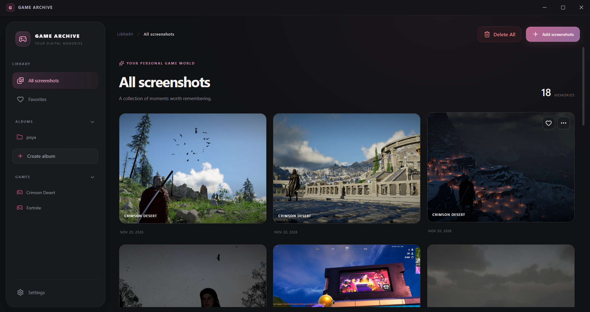
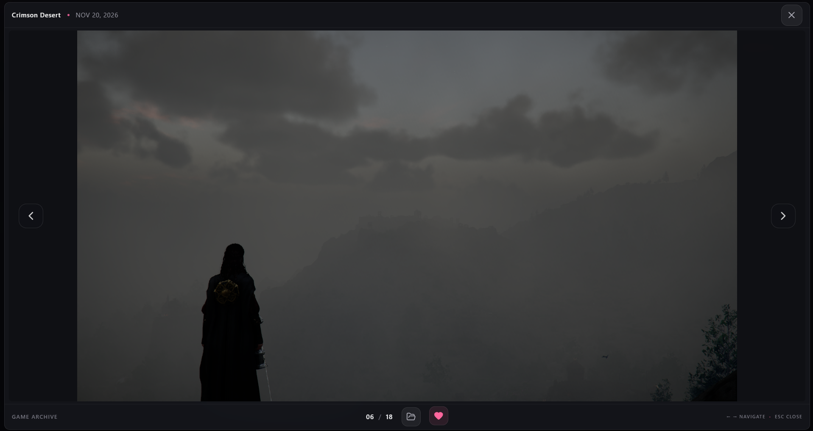
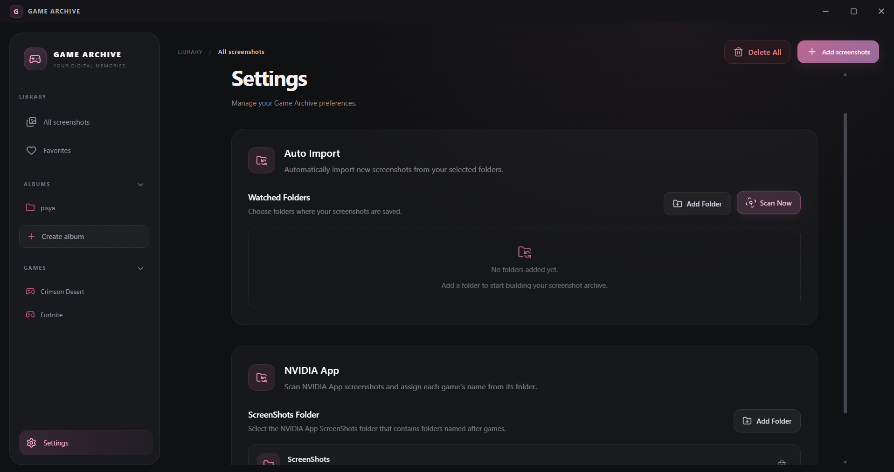

# Game Archive

**Your personal library for gaming screenshots.**

Game Archive is a desktop application designed to help you organize, manage, and revisit your gaming memories. Import screenshots, organize them by game and album, mark your favorites, and browse your collection in a clean, modern interface.

## ✨ Features

- **Screenshot Library** — Keep all your gaming screenshots in one place.
- **Automatic Import** — Automatically import new screenshots from monitored folders.
- **NVIDIA App Integration** — Import screenshots directly from the NVIDIA App's standard `Screenshots` directory, automatically identifying games based on their folder names.
- **Game Organization** — Automatically assign screenshots to their corresponding games.
- **Albums** — Create custom albums and group your favorite moments.
- **Favorites** — Quickly access your most memorable screenshots.
- **Duplicate Detection** — SHA-256 hashing prevents duplicate screenshots from being imported.
- **Thumbnail Generation** — Optimized thumbnails make browsing large collections faster while preserving original image quality.
- **Search & Filtering** — Find screenshots by game, album, or search query.
- **Full-Size Viewer** — View original screenshots with convenient navigation.
- **Local Storage** — Your screenshots and library data stay on your device.

  ## 📸 Screenshots







## 📂 Automatic Screenshot Import

Game Archive provides two ways to automatically import screenshots.

### 1. Custom Watched Folders

Add any folder containing screenshots to the watched folders list in Settings.

Game Archive will periodically scan these folders and automatically import newly discovered screenshots into your library.

### 2. NVIDIA App Integration (Recommended)

NVIDIA App stores screenshots in a dedicated `Screenshots` directory, organized into separate subfolders named after the games.

For example:

```text
Screenshots/
├── Cyberpunk 2077/
│   ├── screenshot_1.png
│   └── screenshot_2.png
├── Red Dead Redemption 2/
│   └── screenshot_3.png
└── Assassin's Creed Shadows/
    └── screenshot_4.png
```

Simply select the main `Screenshots` folder in the dedicated NVIDIA App section of Game Archive Settings.

Game Archive will:
- Scan the directory and its game-specific subfolders.
- Automatically detect game names from folder names.
- Import screenshots and assign the corresponding game automatically.
- Generate optimized thumbnails.
- Skip duplicate screenshots.

**This is the recommended way to use Game Archive:** keep taking screenshots with NVIDIA App as usual, while Game Archive automatically builds and organizes your personal screenshot library in the background.

## 🎨 Design

Game Archive features a modern dark interface inspired by gaming aesthetics, with glass-like surfaces, subtle neon accents, smooth animations, and a focus on making your screenshot collection enjoyable to explore.

## 🛠️ Tech Stack

- **React**
- **TypeScript**
- **Vite**
- **Tauri 2**
- **Rust**
- **SQLite**
- **Tailwind CSS**
- **Motion**
- **React Virtuoso**

## ❤️ Support Game Archive

Game Archive is completely free to use, with no subscriptions or paid features.

If you enjoy the app and would like to support its development, you can buy me a coffee on Ko-fi!

Every contribution, no matter how small, is greatly appreciated and helps me dedicate more time to improving Game Archive.

<p align="center">
  <a href="https://ko-fi.com/noonecar3s">
    
  </a>
</p>

Thank you for supporting independent development! ❤️

## 📦 Installation

Download the latest Windows installer from the [GitHub Releases](../../releases) page.

Run the `.exe` installer and follow the installation instructions.

## 💻 Development

### Prerequisites

- Node.js
- npm
- Rust (stable)
- Microsoft C++ Build Tools
- Tauri 2 development prerequisites

### Getting Started

Clone the repository:

```bash
git clone <repository-url>
cd game-archive
```

Install dependencies:

```bash
npm install
```

Run the application in development mode:

```bash
npm run tauri dev
```

Build the application:

```bash
npm run tauri build
```

Build artifacts are generated in:

```text
src-tauri/target/release/bundle/
```

## 🔒 Privacy

Game Archive is designed as a local-first application. Your screenshot library is stored locally on your device. Original screenshots are not modified during import or thumbnail generation.

## 📌 Project Status

Game Archive is actively developed. Features and interface may evolve over time.

---

**Game Archive — Keep your gaming memories alive.**
